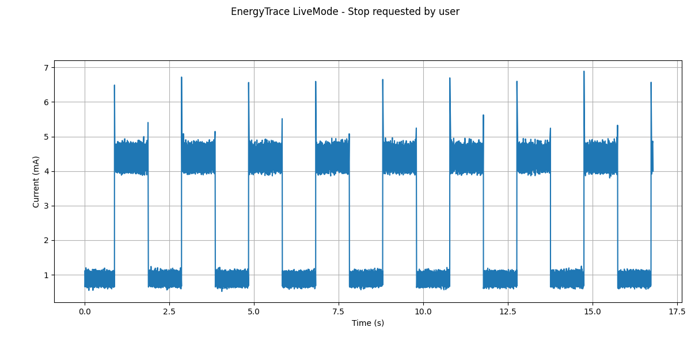
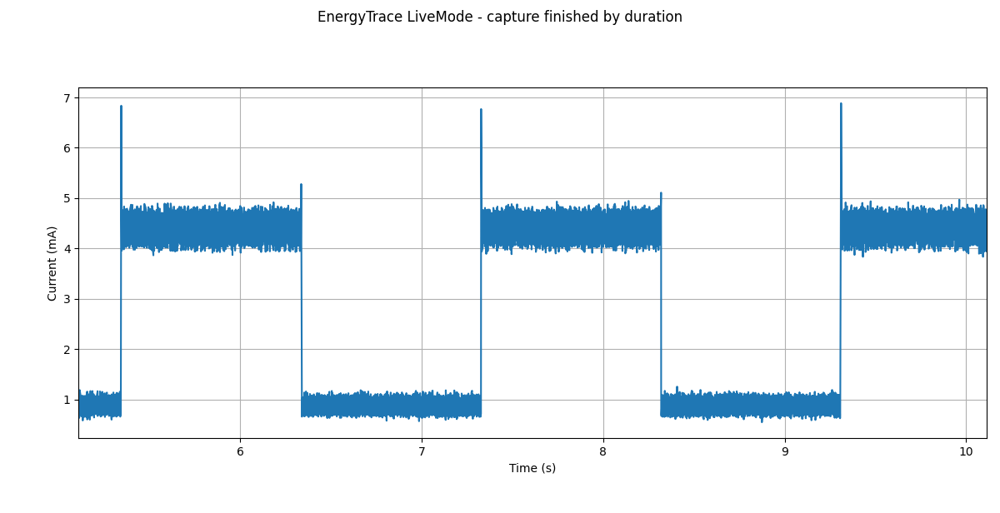

# EnergyTrace Live

A Python-based tool to automate **Texas Instruments EnergyTrace** measurements using TI `stune`, capture current consumption and display the data in real time.

The project is designed to work on **Windows** and **native Linux** when a valid Code Composer Studio installation and XDS110 debug probe are available.

The EnergyTrace feature in CCS 20.x+ requires an active debug connection to the target device. Therefore, the measured current and power may be higher than those obtained with EnergyTrace Live, since the debug interface and related circuitry can contribute to the overall power consumption. Besides that, you can't run it in real time and the total time it runs is really limited.

Older CCS versions (e.g., CCS v12.x) provide an EnergyTrace implementation that can operate without an active debug session, resulting in measurements that are expected to be closer to those obtained with EnergyTrace Live, but it's a legacy version.

---

## Table of Contents

- [Overview](#overview)
- [Features](#features)
- [Requirements](#requirements)
  - [Software](#software)
  - [Python Packages](#python-packages)
- [Installation](#installation)
- [Local Defaults](#local-defaults)
- [Command-Line Parameters](#command-line-parameters)
- [Live Plot](#live-plot)
  - [Controls](#controls)
  - [Terminal Output](#terminal-output)
  - [Interval Analysis](#interval-analysis)
  - [Point Analysis](#point-analysis)
- [Usage Examples](#usage-examples)
  - [Windows](#windows)
  - [Linux](#linux)
- [Output Files](#output-files)
- [Warm-up Routine](#warm-up-routine)
- [Notes About Sampling and Calculations](#notes-about-sampling-and-calculations)
- [Common Issues](#common-issues)
- [License](#license)

---

## Overview

The project uses two main scripts:

```text
run_energytrace_live.py
plot_energytrace_live.py
```

`run_energytrace_live.py` is the main runner. It resolves the CCS/stune path, creates the output folders, starts EnergyTrace, launches the live plot, monitors errors, and stops the capture when requested.

`plot_energytrace_live.py` monitors the CSV files generated by `stune`, plots current in real time, and calculates power and energy internally.

---

## Features

- Runs TI `stune` automatically.
- Supports Windows and native Linux.
- Supports indefinite captures with `--duration 0`.
- Opens a real-time current plot using Matplotlib/Qt.
- Calculates power and accumulated energy internally.
- Uses raw data for energy, average, min, max, and interval analysis.
- Uses downsampling only for plotting performance.
- Allows interactive plot analysis:
  - total consumption;
  - selected interval consumption;
  - point inspection;
- Stores CSV files, logs, and generated `stune` command files in timestamped output folders.
- Accepts CCS path, target configuration, device, duration, window, refresh rate, and EnergyTrace mode from the command line.

---

## Requirements

### Software

- Python 3.8 or newer.
- Texas Instruments Code Composer Studio (it was tested with 20.51 and 21.00).
- TI `stune`, installed with CCS.
- TI LaunchPad/XDS110 with EnergyTrace support.
- A valid `.ccxml` target configuration file.
- Proper USB drivers for the probe.

### Python Packages

Install the required Python packages:

```bash
pip install numpy pandas matplotlib PyQt6
```

`PyQt6` is required because the live plot uses the Matplotlib `QtAgg` backend.

---

## Installation

To install the tool, you can just clone the repository to the location you want to use it, the output folder will be created in the same directory as the `.py` files.

```bash
git clone https://github.com/AcenoTecnologia/energytrace-live.git
```

The scripts can be placed in any directory, as long as both files are kept together in the same folder.

---

## Local Defaults

To avoid repeating machine-specific options, copy `config.example.json` to `config.local.json` and edit the local file with your CCS and target configuration paths:

```bat
copy config.example.json config.local.json
```

The runner automatically loads `config.local.json` when it exists. This file is ignored by Git, so each user can keep different local paths without changing the repository. Command-line arguments override the local file, and an explicit `--settings` file overrides the local file as well.

For example, after creating `config.local.json`, run:

```bat
py run_energytrace_live.py
```

The CCS path and target configuration have no built-in defaults, so both must be provided in one of the JSON/XML settings files or with `--ccs` and `--config`.

The settings priority is: built-in defaults, `config.local.json`, explicit `--settings` file, and command-line arguments.

---

## Command-Line Parameters

| Parameter | Description | Default |
|---|---|---|
| `--ccs` | Path to the CCS installation folder. It can point to the CCS root or directly to the `ccs` folder.* | None |
| `--config`, `--target-config` | Path to the `.ccxml` target configuration file.* | None |
| `--device` | Device name passed to `stune`, for example `CC1352`, the `.ccxml` file defines the actual target, so `--device` and the `.ccxml` target should match. | CC1352 |
| `--voltage` | Fallback voltage used only if the EnergyTrace CSV does not contain voltage data. | 3.3 |
| `--battery-capacity` | Battery capacity in mAh used to estimate battery lifetime from the measured average current. | 220.0 (CR2032) |
| `--no-plot` | Set to `1` to disable the live plot while keeping capture and analysis enabled. | 0 |
| `--duration` | Capture duration in milliseconds. Use `0` for indefinite capture. | 0 |
| `--downsample` | Downsample window in milliseconds used only for plotting. | 0.01 |
| `--refresh` | Live plot refresh time in milliseconds. | 10 |
| `--window` | Visible plot window in seconds. Use `0` to show the full capture. | 0 |
| `--max-points` | Maximum number of points displayed in the live plot. | 2000 |
| `--et-mode` | EnergyTrace mode passed to `stune`. Usually `et`, the `et++` mode may not work for some devices. | et |

The sample frequency parameter is not used by this program because some devices use a fixed EnergyTrace sampling rate.

* Both settings are required. They can be provided in config.local.json, an explicit --settings file, or with the --ccs and --config command-line options.

---

## Live Plot

The live plot displays current consumption in real time.

The plot shows only current, but voltage, power, and energy are still calculated internally.

### Controls

| Action | Description |
|---|---|
| `q` or `Esc` | Stops the EnergyTrace capture and keeps the plot open. |
| `t` | Prints total consumption from the beginning up to the current time. |
| Right click | Prints current, power, and accumulated energy at the nearest point. |
| Left click + drag | Selects an interval and prints interval statistics. |
| Close window | Exits the live plot and stops `stune`. |

`q` and `Esc` are available in both plot mode and no-plot mode.

### Terminal Output

During acquisition, the live plot prints an updating status line:

```text
Pts=125000 | t=1.25s | I=5.620mA | Iavg=5.604mA | E=23.105mJ | Pavg=18.493mW
```

| Field | Meaning |
|---|---|
| `Pts` | Number of processed points. |
| `t` | Current capture time. |
| `I` | Current at the latest point. |
| `Iavg` | Average current since the beginning. |
| `E` | Accumulated energy since the beginning. |
| `Pavg` | Average power since the beginning. |

### Interval Analysis

Selecting an interval in the graphic prints a detailed summary:

```text
=========================================================
INTERVAL
=========================================================
Start:                      0.000004 s
End:                        10.047180 s
Duration:                   10.047176 s

Voltage
  Mean:                     3.300000 V

Current
  Mean:                     3.166208 mA
  Min:                      1.163987 mA
  Max:                      20.081163 mA

Power
  Mean:                     10.448486 mW
  Min:                      3.841157 mW
  Max:                      66.267838 mW

Energy
  Energy in Interval:       104.977774 mJ
  Energy Start:             0.000000 mJ
  Energy End:               104.977774 mJ

Battery Lifetime
  Estimate:                 2 m 9 d 11 h 37 min
=========================================================
```

### Point Analysis

Right clicking on the plot prints the nearest measured point:

```text
=========================================================
POINT
=========================================================
Time:                       2.514328 s
Current:                    5.620000 mA
Power:                      18.546000 mW
Energy:                     46.917300 mJ
=========================================================
```

---

## Usage Examples

To run the script, you must open the terminal in the directory where you cloned the repository and the `.py` files are located.

### Windows

Basic example:

```bat
py run_energytrace_live.py ^
  --ccs "C:\ti\ccs2051" ^
  --config "C:\ti\workspace_ccstheia\timerled_LP_CC1352P7_1_tirtos7_ticlang\targetConfigs\CC1352P7.ccxml"
```

Will generate:

```text
=========================================================
EnergyTrace LiveMode Runner
=========================================================
OS:              Windows

CCS:             C:\ti\ccs2051\ccs
Config:          C:\ti\workspace_ccstheia\timerled_LP_CC1352P7_1_tirtos7_ticlang\targetConfigs\CC1352P7.ccxml

Device:          CC1352
Voltage (V):     3.3
Battery (mAh):   220.0
Plot:            enabled
Duration (ms):   indefinite (0)
Refresh (ms):    10
Window (s):      full capture (0)
ET mode:         et

CSV:             C:\ti\energytrace-live\out\20260826_132420\csv\energytrace_20260826_132420.csv
Log:             C:\ti\energytrace-live\out\20260826_132420\log\stune_log_20260826_132420.txt
=========================================================
```



With capture options:

```bat
py run_energytrace_live.py ^
  --ccs "C:\ti\ccs2051" ^
  --config "C:\ti\workspace_ccstheia\timerled_LP_CC1352P7_1_tirtos7_ticlang\targetConfigs\CC1352P7.ccxml" ^
  --device CC1352 ^
  --battery-capacity 2000 ^
  --duration 10000 ^
  --window 5 ^
  --downsample 0.01 ^
  --refresh 10 ^
  --max-points 2000 ^
  --et-mode et ^
  --no-plot 0
```

Will generate:

```text
=========================================================
EnergyTrace LiveMode Runner
=========================================================
OS:              Windows

CCS:             C:\ti\ccs2051\ccs
Config:          C:\ti\workspace_ccstheia\timerled_LP_CC1352P7_1_tirtos7_ticlang\targetConfigs\CC1352P7.ccxml

Device:          CC1352
Voltage (V):     3.3
Battery (mAh):   2000.0
Plot:            enabled
Duration (ms):   10000.0
Refresh (ms):    10
Window (s):      5.0
ET mode:         et

CSV:             C:\ti\energytrace-live\out\20260826_141259\csv\energytrace_20260826_141259.csv
Log:             C:\ti\energytrace-live\out\20260826_141259\log\stune_log_20260826_141259.txt
=========================================================
```



### Linux

Activate the virtual environment first:

```bash
cd ~/energytrace-live
source .venv/bin/activate
```

Basic example:

```bash
python run_energytrace_live.py \
  --ccs "$HOME/ti/ccs2051" \
  --config "$HOME/ti/CC1352P1F3.ccxml"
```

With capture options:

```bash
python run_energytrace_live.py \
  --ccs "$HOME/ti/ccs2051" \
  --config "$HOME/ti/CC1352P1F3.ccxml" \
  --battery-capacity 2000 \
  --device CC1352 \
  --duration 10000 \
  --window 5 \
  --downsample 0.01 \
  --refresh 10 \
  --max-points 2000 \
  --et-mode et \
  --no-plot 0
```

---

## Output Files

The `out/` folder is created automatically when the tool runs:

```text
out/YYYYMMDD_HHMMSS/
├── csv/
├── log/
└── cmd/
```

The raw EnergyTrace CSV is saved in:

```text
out/YYYYMMDD_HHMMSS/csv/energytrace_YYYYMMDD_HHMMSS.csv
```

The main `stune` log is saved in:

```text
out/YYYYMMDD_HHMMSS/log/stune_log_YYYYMMDD_HHMMSS.txt
```

The warm-up log is saved in:

```text
out/YYYYMMDD_HHMMSS/log/stune_warmup_log_YYYYMMDD_HHMMSS.txt
```

Generated `stune` command files are saved in:

```text
out/YYYYMMDD_HHMMSS/cmd/
```

---

## Warm-up Routine

The runner performs short warm-up captures before the real acquisition.

This helps reduce cases where EnergyTrace reports:

```text
BAD DATA DETECTED
```

after a previous indefinite capture.

If `BAD DATA DETECTED` still appears, try to disconnect and reconnect the LaunchPad.

---

## Notes About Sampling and Calculations

Voltage is read from the CSV when available. If the CSV has no voltage column, the value passed through `--voltage` is used as fallback.

Power is calculated as:

```python
power_W = voltage_V * current_A
```

Energy is calculated by numerical integration of power over time.

Downsampling is used only for plotting performance. Raw data should be used for energy, average, min, max, and interval calculations.

The estimated battery lifetime is calculated by:

```python
lifetime_h = battery_capacity_mAh / avg_current_mA
```

---

## Common Issues

### Unable to load `ccxmlsetup.dll`

This usually means the CCS/stune environment paths are not available.

Check that the `--ccs` path points to a valid CCS installation.

The runner should add these paths automatically:

```text
ccs_base\DebugServer\bin
ccs_base\common\bin
ccs_base\common\uscif
ccs_base\common\uscif\xds110
```

### Unable to load `libccxmlsetup.so`

This means the Linux `stune` executable could not find the required CCS shared libraries.

The runner should set `LD_LIBRARY_PATH` automatically. If testing manually, export the library paths before launching `stune`:

```bash
STUNE="$(find "$HOME/ti" -path "*/ccs_base/emulation/analysis/bin/stune/stune" -type f | head -n 1)"
STUNE_DIR="$(dirname "$STUNE")"
CCS_BASE="${STUNE_DIR%/emulation/analysis/bin/stune}"

LIB_DIRS="$(find "$CCS_BASE" -type f \( -name "libccxmlsetup.so" -o -name "libenergytracestandalone.so" \) -printf '%h\n' | sort -u | paste -sd: -)"

export LD_LIBRARY_PATH="$LIB_DIRS:$STUNE_DIR:$CCS_BASE/DebugServer/bin:$CCS_BASE/common/bin:$CCS_BASE/common/uscif:$CCS_BASE/common/uscif/xds110:${LD_LIBRARY_PATH:-}"
```

### `BAD DATA DETECTED`

This may happen when the XDS110/EnergyTrace session is left in a bad state after a previous capture.

Try:

- disconnecting and reconnecting the LaunchPad;
- closing CCS debug sessions;
- closing UniFlash, SmartRF Studio, Packet Sniffer, serial monitors, and old `stune` processes;
- using a finite capture duration before trying indefinite capture again.

### `Failed to open debug probe handle`

Typical log messages:

```text
-260 :Failed to open debug probe handle.
-261 :Failed to open debug probe handle.
-590 :Failed to open debug probe handle.
-121: Error occurred while closing debug probe port.
```

Possible causes:

- the LaunchPad/XDS110 is not connected;
- another program is using the XDS110;
- the wrong `.ccxml` target configuration is being used;
- the selected CCS/stune version wants to update XDS110 firmware;
- Linux debug probe drivers were not installed;
- WSL/USB/IP is not exposing the required probe interface;
- the XDS110 firmware is in an inconsistent state.

Try:

- closing CCS, UniFlash, SmartRF Studio, Packet Sniffer, and serial monitors;
- reconnecting the LaunchPad;
- testing `stune` manually;
- checking `lsusb` on Linux;
- running the CCS Linux driver script;
- updating or recovering XDS110 firmware with TI `xdsdfu` on Windows if needed;
- using native Windows or native Linux instead of WSL.

---

## License

This project is licensed under the GNU General Public License v3.0. See the `LICENSE` file for more details.
